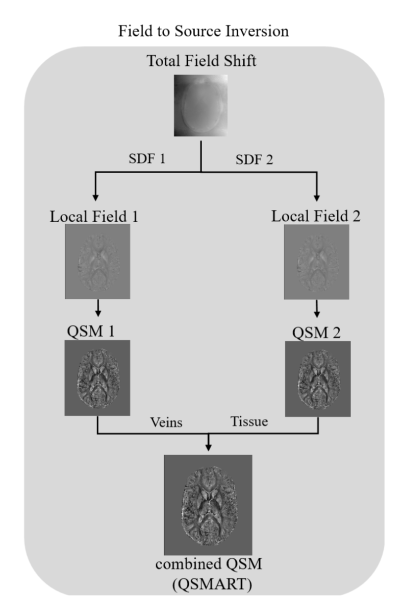

# QSMART: Quantitative Susceptibility Mapping Artifact Reduction Technique

QSMART estimates tissue bulk magnetic susceptibility maps from complex MRI images.
* QSMART is a two-stage QSM inversion pipeline that suppresses artifacts and the streaking artifacts near veins (Figure 1).
* Spatially dependent filtering is applied to a combined cortical surface and vasculature mask as part of the QSMART pipeline, eliminating the need for the cortical erosion step of SHARP-based methods.
* QSMART shows superior artifact suppression on 7T human and 9.4T preclinical data compared to the previous methods.

## Installing QSMART

1. Download QSMART [repository](https://github.com/MBCIU/QSMART/archive/main.zip) 
2. To install QSMART, a number of dependencies need to be available on your system, as listed below. These depedencies can be added to the MATLAB path or placed directly in the folder *'QSMART_toolbox_v2.0'*.

Required dependencies:
1. [Frangi filter](https://au.mathworks.com/matlabcentral/fileexchange/24409-hessian-based-frangi-vesselness-filter) 
2. [STI suite v2.2](https://people.eecs.berkeley.edu/~chunlei.liu/software.html)
3. Code for [phase unwrapping](https://github.com/sunhongfu/QSM/tree/master/phase_unwrapping)
4. [Nifti tools](https://au.mathworks.com/matlabcentral/fileexchange/8797-tools-for-nifti-and-analyze-image)
5. Code for calculating [gaussian curvature](https://www.mathworks.com/matlabcentral/fileexchange/61136-gaussian-and-mean-curvatures-calculation-on-a-triangulated-3d-surface)

Additionally, please install the latest version of these software on your system.
* [FSL](https://fsl.fmrib.ox.ac.uk/fsl/fslwiki/FslInstallation)
* [Advanced Normalization Tools (ANTs)](http://stnava.github.io/ANTs/)

QSMART runs `N4BiasFieldCorrection` (ANTs) and `bet2` (FSL) from the system path that MATLAB sees, and stops with an error if either is missing. If MATLAB does not inherit your shell's path, add them with `setenv('PATH', [getenv('PATH') ':/path/to/ants/bin:/path/to/fsl/bin'])`.

## Usage

The script *Demo_QSMART.m* calls the main *QSMART* function and contains a description of user-specified parameters. The parameter settings have been optimized for multiecho gradient echo data from Siemens 7T MRI scanner. To run *Demo_QSMART.m* on your data, please specifiy paths to phase and magnitude DICOM folders, and adjust parameters as needed.

### Changes in v2.0

Version 2.0 changes these defaults in *Demo_QSMART.m* so that QSMART works on data from different scanners and resolutions without retuning. Each change can be switched back to v1.0's behaviour.

* **Frangi's c is set from the image** (`frangi_C_mode = 'relative'`): c = 0.25 × the median N4-corrected magnitude in the brain. A fixed c (`'absolute'`, v1.0's 500) depends on the scanner's intensity scale.
* **Adaptive thresholds** (`adaptive_threshold = 1`): the brain-mask magnitude and echo-fit thresholds are percentiles of the data (2nd and 99th) rather than fixed values.
* **Sizes in mm** (`size_units = 'mm'`): morphology radii and Frangi scales are in mm, converted with the mean voxel size. The defaults are v1.0's voxel values at the 0.6 mm resolution they were tuned on. `'voxels'` keeps v1.0's units.
* **Repeatable runs**: N4 runs with a fixed thread count (`n4_threads = 1`).
* **A warning when the vessel mask covers more than 20 % of the brain** (`vessel_coverage_warning`).
* ANTs and FSL are run from the system path instead of with `module load`.
* Small numerical fixes: the offset adjustment's k-space grid on odd matrix sizes, the constant left free by Laplacian unwrapping, and one gyromagnetic ratio throughout.

### QSMART Estimation Pipeline
* Load complex image data from DICOMS (Magnitude and phase images)
* Inital brain mask using [FSL's BET](https://fsl.fmrib.ox.ac.uk/fsl/fslwiki/BET/UserGuide)
* Coil combination using [POEM multi-channel coil combination method](https://github.com/sunhongfu/QSM)
* Vasculature mask using Frangi filters and curvature-based indent mask
* Phase unwrapping
* Echo-fitting
* **Stage 1:** Background field removal using spatial dependent filtering
* Field-to-source inversion using [iLSQR](https://www.ncbi.nlm.nih.gov/pmc/articles/PMC4406048/)
* **Stage 2:** Background field removal using spatial dependent filtering, vasculature mask and indent mask, followed by iLSQR inversion
* Combined QSMART susceptibility map from stages 1&2

  
**Figure 1:** Overview of the QSMART field-to-source inversion step; background field removal and inversion are carried out in two parallel stages, once on the whole ROI and once on the tissue region only (vasculature omitted). The two QSM maps are combined to form the final QSM map (QSMART).

## References

**QSMART Reference:** Yaghmaie, N., W. Syeda, C. Wu, Y. Zhang, T. Zhang, E.L. Burrows, B.A. Moffat, D.K. Wright, R. Glarin, S. Kolbe, L.A. Johnston, *QSMART: Quantitative Susceptibility Mapping Artifact Reduction Technique*, 2020.

QSMART uses helper codes from following references:

* Dirk-Jan Kroon (2020). Hessian based Frangi Vesselness filter (https://www.mathworks.com/matlabcentral/fileexchange/24409-hessian-based-frangi-vesselness-filter), MATLAB Central File Exchange. Retrieved September 6, 2020.
*  Alireza Dastan (2020). Gaussian and mean curvatures calculation on a triangulated 3d surface 
% (https://www.mathworks.com/matlabcentral/fileexchange/61136-gaussian-and-mean-curvatures-calculation-on-a-triangulated-3d-surface), 
% MATLAB Central File Exchange. Retrieved October 23, 2020.
* H. Sun, J.O. Cleary, R. Glarin, S.C. Kolbe, R.J. Ordidge, B.A. Moffat, G.B. Pike, *Extracting more for less: Multi-echo MP2RAGE for simultaneous T1-weighted imaging, T1 mapping, R2* mapping, SWI, and QSM from a single acquisition.*

